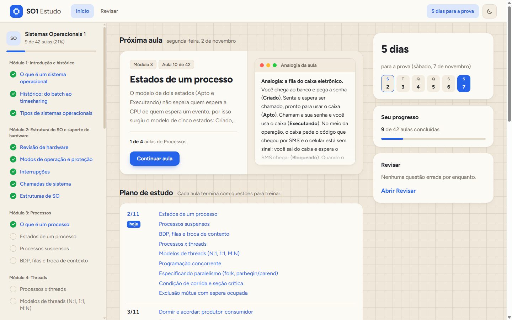
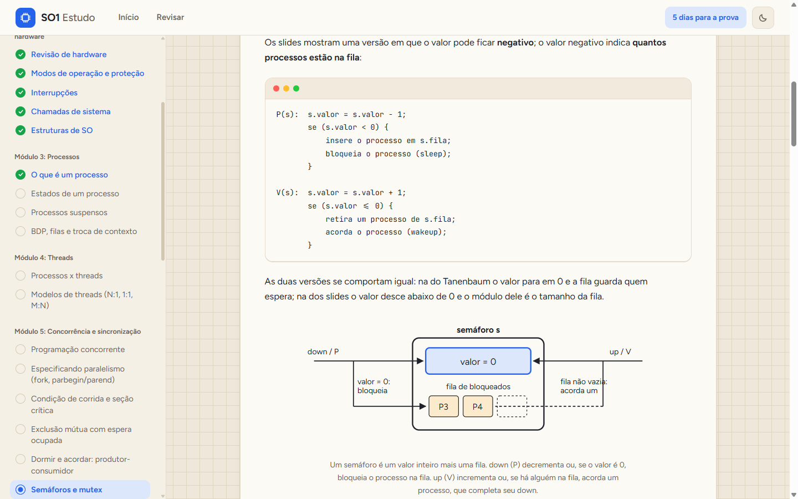
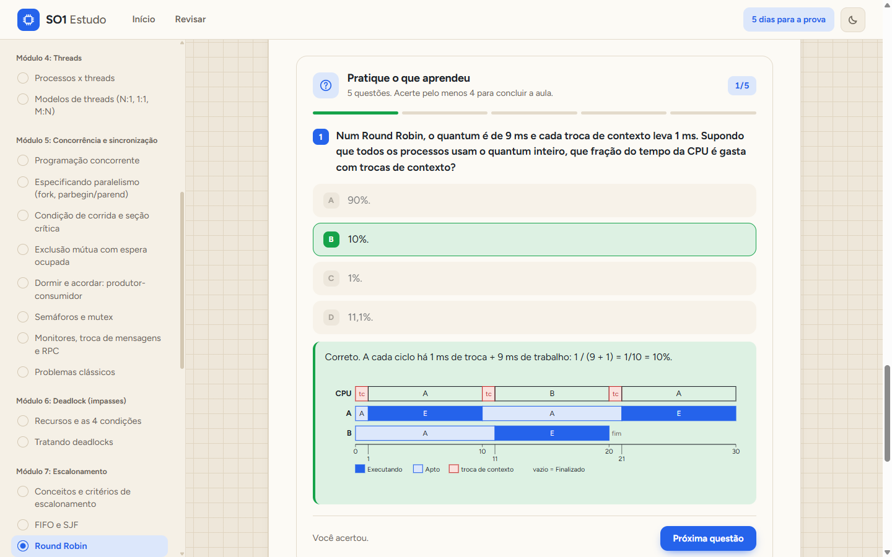
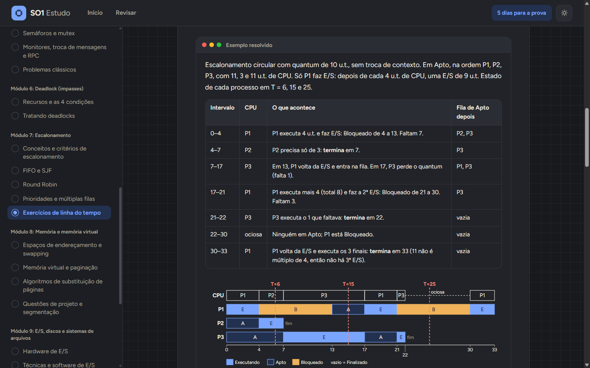

# SO1 Estudo

Site de estudo de **Sistemas Operacionais**, organizado como um curso: 10 módulos, 42 aulas e mais de 390 questões de prática. Construí este site para me preparar para uma prova de proficiência que cobre a ementa inteira da disciplina, de processos e escalonamento até memória virtual e sistemas de arquivos.

**Acesse:** [so1-estudo.vercel.app](https://so1-estudo.vercel.app/)



## O que tem

- **42 aulas curtas** com analogia, explicação, exemplo resolvido, pegadinhas comuns e resumo, divididas em 10 módulos: introdução, estrutura do SO, processos, threads, concorrência e sincronização, deadlock, escalonamento, memória, E/S e sistemas de arquivos, e estudos de caso (UNIX/Linux e Windows).
- **61 diagramas em SVG** feitos à mão: diagrama de estados, linha do tempo (Gantt) de escalonamento, tabelas de páginas, RAID, entre outros. As cores seguem o tema claro ou escuro.
- **343 questões de múltipla escolha** com explicação para cada alternativa, inclusive as erradas. É preciso acertar 4 de 5 para concluir a aula.
- **53 questões dissertativas** com resposta-modelo e uma lista de pontos-chave para a autoavaliação.
- **Exercícios numéricos de escalonamento** (SJF, Round Robin com E/S e troca de contexto) com gabaritos conferidos à mão e por um simulador.
- **Progresso** salvo no navegador, a próxima aula em destaque com um trecho dela e uma página **Revisar** que junta as questões erradas e as aulas marcadas.

| Aula com bloco de código | Quiz com verificação |
|---|---|
|  |  |

| Tema escuro | Celular |
|---|---|
|  |  |

## Decisões técnicas

- **HTML, CSS e JavaScript puros, sem framework e sem build.** O site abre direto pelo `index.html`, inclusive via `file://`, sem servidor. Por isso as aulas são arquivos `.js` que se registram com `SO1.registerLesson(...)` em vez de JSON carregado com `fetch`.
- **Carregamento sob demanda:** o índice dos módulos é pequeno, e cada aula só é baixada quando aberta.
- **Funciona offline:** as fontes (Figtree e JetBrains Mono) ficam no próprio projeto, sem CDN.
- **Design:** visual de caderno bege com grade e detalhes em azul, janelas no estilo macOS para código e exemplos, e tema claro/escuro feito com variáveis CSS (os diagramas SVG usam as mesmas variáveis).
- **Acessibilidade:** navegação por teclado (atalhos A–D no quiz, Esc fecha o menu), `aria-current`, `aria-pressed`, barras de progresso com `role="progressbar"` e suporte a `prefers-reduced-motion`.
- **Responsivo:** no celular a lista de aulas vira um menu lateral, e as tabelas largas viram cartões.
- **Testes automatizados** com o test runner nativo do Node: lógica do quiz, do progresso e do plano de estudo, renderização e validação do formato das 42 aulas (ids únicos, 4 alternativas com exatamente uma correta, explicações, fontes etc.).

## Estrutura

```
index.html          página única (roteamento por hash: #/, #/aula/<id>, #/revisar)
css/style.css       tema, layout e componentes
js/core/            registro de aulas, quiz, progresso (localStorage) e plano de estudo
js/ui/render.js     funções que geram o HTML de cada tela
js/app.js           roteador, eventos e quiz interativo
conteudo/           índice dos módulos e uma pasta por módulo com as aulas
tests/              testes (node --test)
fonts/              Figtree e JetBrains Mono (licença OFL)
```

## Como rodar

Abra o `index.html` no navegador. Não precisa instalar nada.

Para rodar os testes (Node 22 ou superior):

```bash
node --test "tests/*.test.js"
```

## Conteúdo e bibliografia

O texto das aulas, os diagramas e as questões são autorais. As explicações seguem a bibliografia da disciplina, citada no fim de cada aula:

- TANENBAUM, A. S. *Sistemas Operacionais Modernos*. 3ª ed. Pearson.
- OLIVEIRA, R. S.; CARISSIMI, A. S.; TOSCANI, S. S. *Sistemas Operacionais*. 4ª ed. Bookman (Série UFRGS).
- MACHADO, F. B.; MAIA, L. P. *Arquitetura de Sistemas Operacionais*. 5ª ed. LTC.
- SILBERSCHATZ, A.; GALVIN, P. B.; GAGNE, G. *Fundamentos de Sistemas Operacionais*. LTC.

## Como foi feito

Desenvolvi o projeto usando o [Claude Code](https://claude.com/claude-code) como harness de agentes, escolhendo o modelo e as skills de cada etapa:

1. **Planejamento com o Opus.** Usei a skill *brainstorming* do [superpowers](https://github.com/obra/superpowers) para levantar os requisitos: público, formato das aulas e das questões, restrições técnicas (sem build, funcionar via `file://`) e quais fontes eram confiáveis. Daí saíram uma especificação e um plano de implementação dividido em tarefas.
2. **Execução com vários agentes no Sonnet.** Com o plano bem definido, a implementação foi distribuída entre subagentes, cada um responsável por uma tarefa ou por um módulo de conteúdo e trabalhando em seu próprio *git worktree*.
3. **Revisão independente.** Cada módulo passou por um agente revisor separado do autor, que conferiu o conteúdo com a bibliografia e recalculou os exercícios numéricos. No fim, uma revisão cruzada verificou a coerência entre os módulos.
4. **Validação.** Os testes automatizados rodam a cada mudança, e as 42 aulas foram abertas num Chrome headless, no tema claro e no escuro, no computador e no celular, para checar erros de JavaScript, rolagem horizontal e o fluxo completo do quiz.
